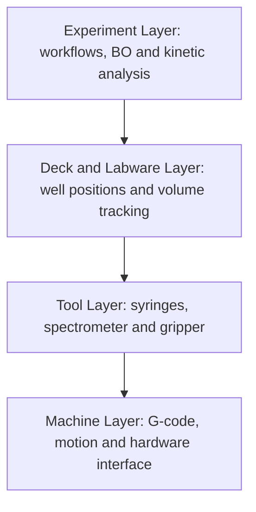

[](https://doi.org/10.5281/zenodo.19664269)

# Kinetics-aware control of autonomous batch synthesis

> **Kinetics-aware autonomous batch synthesis for ZIF-67 crystallization using robotic liquid handling, in situ UV–Vis spectroscopy, and adaptive Bayesian optimization**

This repository contains the software, analysis workflows, and supporting assets for **Axo**, a modular autonomous platform for solution-phase batch synthesis. The platform integrates robotic reagent delivery, programmable tool changing, cyclic in situ UV–Vis measurements, kinetic model fitting, and Bayesian optimization with kinetics-aware execution to select **what formulation to test** and **how the experiment should be executed**. ZIF-67 is the principal case study; a supplementary ZIF-8 demonstration is reported in the Supplementary Information (SI).

---

## 🌟 Key Features

### Kinetics-Aware Adaptive Execution

- **Adaptive scheduling**: 
  - **Throughput-prioritized exploration**: 5-vial batch, 15 min measurement interval
  - **Measurement-prioritized refinement**: 2-vial batch, 5 min measurement interval
- **Kinetics-aware trigger**: Set the next batch's execution mode when the early extent of reaction exceeds the threshold `α(t₁) > 0.5`
- **Flexible approval modes**: Optional pause at mode changes or automatic switching in the integrated controller
- **State persistence**: Save optimization checkpoints and resume after checking the physical apparatus state

### Automated Synthesis & Characterization

- **Robotic liquid handling**: Precise dispensing with single/dual syringe systems
- **In situ monitoring**: Cyclic UV–Vis spectroscopy integrated into the batch synthesis workflow
- **Autonomous mixing**: Automated mixing and reaction control
- **Programmable multi-vial workflows**: Batch synthesis and cyclic monitoring across multiple reaction vials

### Intelligent Data Analysis

- **Gualtieri kinetic fitting**: Automated MOF growth curve analysis
- **Extent-of-reaction extraction**: Estimate `α(t)` from the optical trajectory and obtain the Gualtieri nucleation descriptor `k_n = 1/a`
- **Gaussian Process modeling**: Uncertainty-aware surrogate models
- **Expected Improvement**: Efficient exploration-exploitation balance

### Execution Records & Configuration

- **Comprehensive logging**: Experiment metadata, synthesis recipes, operation logs, reference spectra, and time-resolved UV–Vis outputs
- **Error handling**: Graceful handling of excluded or failed fits (`no_reaction`, `no_target_feature`)
- **Motion configuration**: Homing, tool offsets and Z clearances configured for the installed apparatus
- **Configuration management**: JSON-based hardware and experiment configs

---

## 📋 Table of Contents

- [System Architecture](#system-architecture)
- [Installation](#installation)
- [Hardware Requirements](#hardware-requirements)
- [Quick Start](#quick-start)
- [Usage](#usage)
- [Project Structure](#project-structure)
- [Documentation](#documentation)
- [Testing](#testing)

---

<a id="system-architecture"></a>

## 🏗️ System Architecture

The platform is organized into **four main abstraction layers**:



**Communication**: HTTP REST API to Duet 3 controller (RepRapFirmware)

---

<a id="installation"></a>

## 💻 Installation

### Prerequisites

- **Offline examples**: Python 3.12 (reference version: 3.12.14) and pip. A robot, spectrometer and vendor drivers are not required.
- **Hardware operation**: The configured Jubilee/Duet platform, an OceanDirect SDK installation, compatible vendor drivers and local calibration. The recorded hardware notebook used Python 3.11.16 in a separate instrument environment.
- **Network**: Internet access for package installation; a local connection to Jubilee for physical experiments. The installed offline examples run without a network connection.

### Setup

The commands below are for the **offline environment**, using Python 3.12. Run them from the `Axo_MOF` folder unless stated otherwise.

1. **Clone the repository**:

   ```bash
   git clone https://github.com/camsunlab/Axo_MOF.git
   cd Axo_MOF
   ```

   Alternatively, download and extract the repository, then open a terminal in its root folder.

2. **Create a virtual environment**:

   ```bash
   python -m venv .venv
   ```

   Activate on Windows PowerShell:

   ```powershell
   .\.venv\Scripts\Activate.ps1
   ```

   Or on Linux/macOS:

   ```bash
   source .venv/bin/activate
   ```

3. **Install the pinned dependencies and local package**:

   ```bash
   python -m pip install -r Code/requirements-offline.txt
   python -m pip install --no-deps --no-build-isolation -e ./Code
   ```

   `Code/requirements-offline.txt` pins direct and transitive dependencies; `Code/pyproject.toml` defines the local `axo-mof` package (Python import name: `science_jubilee`).

4. **Verify the installation**:

   ```bash
   python -m pip check
   python Code/offline_demo.py --output offline_demo_outputs
   ```

5. **Run the offline notebook**:

   ```bash
   python -m ipykernel install --sys-prefix --name axo-offline --display-name "Axo offline (Python 3.12)"
   jupyter lab Code/offline_demo.ipynb
   ```

   Select the **Axo offline (Python 3.12)** kernel. Inputs, expected outputs and validation commands are documented in [Code/README_offline.md](Code/README_offline.md).

6. **For physical experiments**, follow [Code/README_autonomous_run.md](Code/README_autonomous_run.md) in the apparatus's instrument environment. Install the vendor's OceanDirect SDK and native libraries, and configure the instrument address, paths, deck, tool offsets and syringe/probe calibration.

The root `requirements.txt` is a legacy hardware dependency list. Use the pinned Python 3.12 environment above for the offline examples and the separate instrument environment for hardware operation.

<details>
<summary>Using Windows Git Bash for environment activation</summary>

```bash
source .venv/Scripts/activate
```

Then continue with step 3 above.
</details>

---

<a id="hardware-requirements"></a>

## 🔧 Hardware Requirements

### Core Platform

- **Jubilee 3D printer** (modified for lab automation)
- **Duet 3 controller** running RepRapFirmware
- **Network connection** (Ethernet or WiFi)

### Tools (mounted on tool changer)

- **T0**: Single syringe (precise liquid dispensing)
- **T2**: Dual syringe (parallel dispensing)
- **T3**: Ocean Optics spectrometer (in situ UV–Vis dip-probe measurements)
- **T4**: Vacuum gripper (lid handling)

### Labware

- SLAS-standard microplates (6-slot deck)
- 10-well sample vials (14 mL capacity)
- 2-well precursor reservoirs (60 mL capacity)

---

<a id="quick-start"></a>

## 🚀 Quick Start

**Hardware-independent examples** — run from the repository root after installation:

```bash
python Code/offline_demo.py --output offline_demo_outputs
python Code/simulate.py --quick --output simulation_outputs
```

The first example analyses one recorded five-vial ZIF-67 batch and writes kinetic fits, BO recommendations, a batch plan and plots. The second runs multi-round optimization with synthetic spectra. See [Code/README_offline.md](Code/README_offline.md) for inputs and expected outputs.

### Option 1: Command-Line Interface (Configured Hardware)

These commands operate laboratory hardware. Review `setup_hardware()` in `Code/run_bo_optimization.py`, including its local address, paths and calibration, before use. Start from the repository root.

**Kinetics-aware optimization with pauses at mode changes:**

```bash
cd Code
python run_bo_optimization.py --policy reaction-aware --new
```

**Automatic mode switching:**

```bash
python run_bo_optimization.py --policy reaction-aware --new --no-phase-pause
```

**Legacy single-phase BO utility:**

```bash
python run_bo_optimization.py --policy phases --new --phases single --batch-size 5 --max-iterations 20
```

The `reaction-aware` policy uses the manuscript's `k_n` objective; the legacy `phases` policy uses `I_max` and generic phase settings.

**Resume a saved run after checking the apparatus state:**

```bash
python run_bo_optimization.py --policy reaction-aware --resume
```

### Option 2: Jupyter Notebook (Recommended for Interactive Use)

From the repository root:

```bash
cd Code
jupyter lab autonomous_mof_synthesis.ipynb
```

The notebook provides:

- Step-by-step hardware initialization
- Interactive configuration
- In situ monitoring
- Kinetic fitting, BO and execution-mode decisions
- Built-in visualization and saved run records

The notebook retains the supplementary ZIF-8 configuration, with the 590-nm gate disabled (`FEATURE_GATE_NM = None`). ZIF-67 uses this gate. See [Code/README_autonomous_run.md](Code/README_autonomous_run.md) for chemistry and monitoring settings.

---

<a id="usage"></a>

## 📖 Usage

### Adaptive Execution

The main ZIF-67 workflow uses **two execution modes**:

| Mode | Goal | Batch Size | Measurement Interval (min) | Exploration (xi) | 
|-------|------|------------|----------------------------|------------------|
| **Throughput-prioritized** | Broad screening | 5 | 15 | 0.01 | 
| **Measurement-prioritized** | More frequent kinetic measurements | 2 | 5 | 0.01 | 

**Mode Transition Criteria:**

- Switch to the measurement-prioritized mode when at least one optically eligible, fitted trajectory has `α(t₁) > 0.5` at its first follow-up measurement (nominally 15 min after the baseline in the throughput-prioritized mode).
- Evaluate this rule after the batch has been measured and analysed, and apply the resulting batch size and measurement interval to the **next batch**. Measurements within a batch follow its assigned schedule.
- If no eligible fitted trajectory exceeds the threshold, retain the throughput-prioritized mode. Once the main two-mode workflow switches, it retains the measurement-prioritized mode.

**Dynamic adaptation:** BO determines **what formulation to test**, while the kinetics-aware rule determines **how the next batch is executed**. Faster early reaction progress triggers smaller batches and more frequent measurements with the shared probe. The fixed-execution BO comparison keeps five-vial batches and a 15-min interval while continuing to update formulations.

The original ZIF-67 experiments used modular workflows, with mode changes applied manually according to this rule. The integrated `ReactionAwareBOLoop` implements automatic switching and was used in the supplementary ZIF-8 experiments.

### Command-Line Arguments

The hardware CLI retains both the kinetics-aware and legacy phase policies:

```text
python run_bo_optimization.py [OPTIONS]

Required (choose one):
  --new                   Start new optimization
  --resume                Resume from saved state

Policy:
  --policy {reaction-aware,phases}
                          Default: reaction-aware

Kinetics-Aware Options:
  --alpha-threshold VALUE Default: 0.5
  --no-phase-pause        Switch modes without pausing
  --max-bo-batches N      Maximum 5-vial BO batches (default: 10)
  --max-validation-batches N
                          Number of 2-vial batches (default: 4)
  --max-total-vials N     Optional total vial budget

Legacy Phase Options (only with --policy phases):
  --approval-mode {manual,automatic}
                          Phase transition approval mode (default: manual)
  --phases {multi,single}
                          Phase configuration (default: multi)
  --batch-size N          Single-phase batch size (default: 5)
  --max-iterations N      Single-phase iteration limit (default: 20)

General Options:
  --output-dir DIR        Output directory (default: optimization_results)
  --operator NAME         Operator name (default: Operator)
```

Additional resume options are documented in [Code/README_autonomous_run.md](Code/README_autonomous_run.md).

### Workflow Example

After configuring the hardware, run from `Code/`:

```bash
# Start kinetics-aware optimization with automatic mode switching
python run_bo_optimization.py --policy reaction-aware --new --no-phase-pause --operator "Alice"

# Workflow:
# 1. Generate 5 initial formulations by maximin sampling
# 2. Prepare the configured vial positions and reagent supply
# 3. Run automated synthesis and time-resolved UV-Vis acquisition
# 4. Screen the spectra and fit eligible trajectories with the Gualtieri model
# 5. Evaluate early alpha(t1) to determine the next execution mode
# 6. Update the GP using kinetic scores and select the next formulations by EI
# 7. Execute the next batch using the chosen batch size and measurement interval
# 8. Save recipes, spectra, fit results, decisions and optimization state
# 9. Repeat within the configured run limits and report the best observed condition
```

For ZIF-67, the 400-nm signal supplies the kinetic trajectory and the 590-nm feature gate screens the target optical response. The objective is `k_n = 1/a`; gate failures receive a zero optimization score, which is not a measured physical rate. Processing details are in [Code/README_offline.md](Code/README_offline.md).

### Jupyter Notebook Workflow

See [autonomous_mof_synthesis.ipynb](Code/autonomous_mof_synthesis.ipynb) for:

- Interactive hardware setup and calibration
- Experiment-specific chemistry, optical gates and monitoring configuration
- Progress visualization
- Post-optimization analysis and plotting

The earlier [multi_phase_bo_orchestration.ipynb](Code/multi_phase_bo_orchestration.ipynb) remains available as a generic phase-orchestration example.

---

<a id="project-structure"></a>

## 📁 Project Structure

| Path | Contents |
| --- | --- |
| `Code/src/science_jubilee/Machine.py` | Core machine controller |
| `Code/src/science_jubilee/Experiment.py` | High-level experiment workflows |
| `Code/src/science_jubilee/tools/` | Single/dual syringes, spectrometer and vacuum gripper |
| `Code/src/science_jubilee/labware/`, `decks/` | Labware definitions and deck configurations |
| `Code/src/science_jubilee/analysis/gualtieri.py` | Spectral processing and kinetic fitting |
| `Code/src/science_jubilee/optimization/reaction_aware.py` | Kinetics-aware execution and BO controller |
| `Code/src/science_jubilee/optimization/bayesian.py`, `sampling.py` | GP modelling, EI and initial sampling |
| `Code/src/science_jubilee/optimization/orchestrator.py`, `phase_config.py`, `phase_manager.py` | Legacy generic phase orchestration |
| `Code/src/science_jubilee/optimization/convergence.py`, `notifications.py`, `logging_config.py` | Stopping criteria, operator messages and logging |
| `Code/src/science_jubilee/utils/synthesis_plan.py` | Experiment plan generation |
| `Code/autonomous_mof_synthesis.ipynb` | Integrated hardware notebook |
| `Code/run_bo_optimization.py` | Hardware CLI with selectable policies |
| `Code/mof_synthesis.ipynb`, `multi_phase_bo_orchestration.ipynb` | Earlier modular synthesis and generic orchestration notebooks |
| `Code/bayesian.ipynb`, `gualtieri.ipynb`, `sampling.ipynb` | BO, kinetic analysis and initial sampling notebooks |
| `Code/draft_synthesis_plan.json` | Example synthesis-plan configuration |
| `Code/offline_demo.py`, `offline_demo.ipynb`, `simulate.py` | Recorded-data and synthetic-data examples |
| `Code/pyproject.toml`, `requirements-offline.txt` | Package configuration and pinned offline dependencies |
| `Code/tests/`, `expected_offline_output/` | Software checks and reference numerical outputs |
| `Dataset/` | Recorded experimental data; locations are listed below |
| `CAD/`, `docs/` | Mechanical designs, build instructions and API documentation |
| `README.md` | This file |

Each recorded experiment folder contains `spectra/`, `references/`, `experiment_metadata.json`, `mof_recipes.json` and `operations_log.txt`, preserving the per-vial measurements, reference spectra, recipes and chronological operation records.

---

<a id="documentation"></a>

## 📚 Documentation

### For Users

- **[Quick Start Notebook](Code/autonomous_mof_synthesis.ipynb)**: Integrated experimental workflow
- **[Hardware Workflow Guide](Code/README_autonomous_run.md)**: Instrument environment and apparatus configuration
- **[Offline Guide](Code/README_offline.md)**: Installation, example inputs, expected outputs and verification
- **[Build and API Documentation](docs/)** and **[CAD Files](CAD/)**: Apparatus construction and hardware references

### Example Notebooks

- **[mof_synthesis.ipynb](Code/mof_synthesis.ipynb)**: Manual synthesis workflows and calibration
- **[bayesian.ipynb](Code/bayesian.ipynb)**: BO analysis and visualization
- **[gualtieri.ipynb](Code/gualtieri.ipynb)**: Spectral analysis and kinetic fitting
- **[sampling.ipynb](Code/sampling.ipynb)**: Initial space-filling / maximin sampling
- **[offline_demo.ipynb](Code/offline_demo.ipynb)**: Recorded-data analysis without laboratory hardware

### Experimental Data

| Study | Location |
| --- | --- |
| Main ZIF-67 study: original BO and sampling data | Original experiment folders under [Dataset/](Dataset/) |
| Main ZIF-67 study: added fixed-execution BO batches | [Dataset/ZIF67_fixed_execution/raw/](Dataset/ZIF67_fixed_execution/raw/) |
| Supplementary ZIF-8 demonstration | [Campaign data and run records](Dataset/ZIF8_20261104/) and [benchmark data](Dataset/ZIF8_benchmark/raw/) |

The fixed-execution folder contains the two added five-vial batches; earlier and shared inputs remain in their original locations under `Dataset/`. The ZIF-8 archive includes the original executed notebook and decisions, with details in its [README](Dataset/ZIF8_20261104/README.md).

### Archived Release

The source code and recorded datasets are archived on [Zenodo, DOI: 10.5281/zenodo.19664270](https://doi.org/10.5281/zenodo.19664270). This DOI identifies the earlier release published on 20 April 2026. Record the Git commit or release tag used for an analysis and cite its matching archived version when available.

---

<a id="testing"></a>

## 🧪 Testing

Run these checks from the repository root in the Python 3.12 offline environment.

1. **Recorded-data analysis and reference outputs**:

   ```bash
   python Code/tests/run_offline_isolation.py --output offline_check_outputs
   python Code/tests/verify_offline_outputs.py --output offline_check_outputs
   ```

2. **Multi-round simulation and saved-state checks**:

   ```bash
   python Code/tests/run_simulation_check.py --output simulation_check_outputs
   ```

3. **Integrated notebook dry run with simulated devices**:

   ```bash
   python Code/tests/notebook_dry_run.py Code/autonomous_mof_synthesis.ipynb notebook_dry_run_outputs --truth fast --in-process
   ```

These checks run without laboratory hardware. See the [offline validation](docs/offline_validation.md) and [simulation validation](docs/simulation_validation.md) records for their tested scope.
